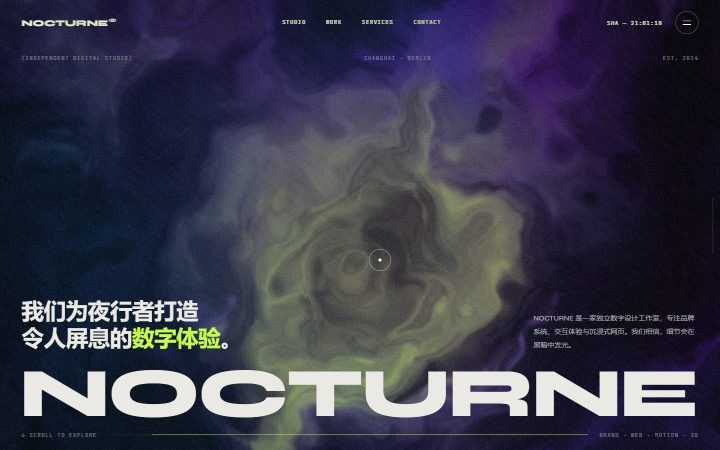
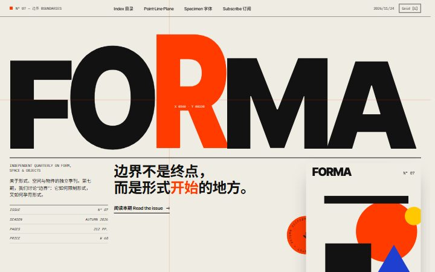
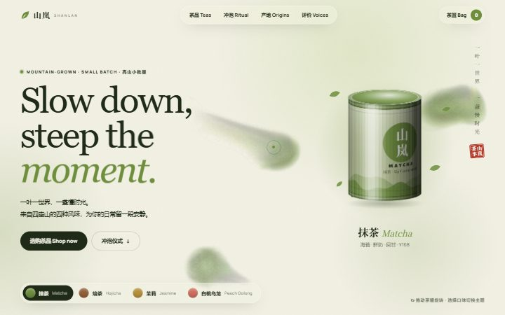
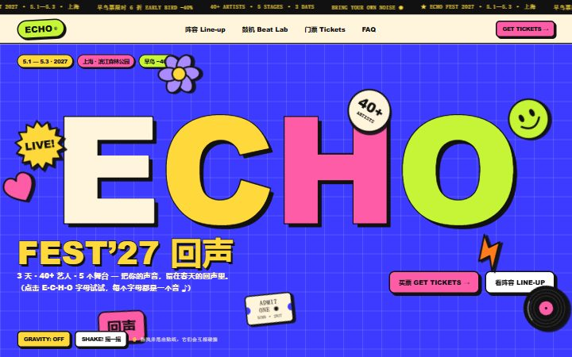

# Four Sites · 四个设计感网站

四个风格完全不同、交互丰富的网站，每一个都是**单个 HTML 文件**：原生 HTML / CSS / JavaScript 手写，不用框架，不需要构建。

**在线浏览 → https://techventor.github.io/design-showcase/**

| 预览 | 网站 | 风格 | 交互与动效 |
|---|---|---|---|
|  | [NOCTURNE](https://techventor.github.io/design-showcase/nocturne/) | 暗夜电影感数字工作室 | WebGL 流体着色器背景、惯性滚动、竖滚转横向作品区、卡片展开成全屏案例、磁吸按钮与自定义光标 |
|  | [FORMA Nº07](https://techventor.github.io/design-showcase/forma/) | 瑞士国际主义设计杂志 | 十字准线坐标光标、随鼠标拉伸的刊名、可重组的包豪斯封面、FLIP 筛选与视图切换、滚动构成「点·线·面」、字体样张 |
|  | [山岚 Shanlan](https://techventor.github.io/design-showcase/shanlan/) | 柔和有机风茶饮品牌 | 鼠标搅动的 WebGL 茶墨、可拖拽旋转的 3D 茶罐、View Transitions 圆形换色、茶汤随滚动注满文字、冲泡动画、飞入购物车 |
|  | [ECHO FEST ’27](https://techventor.github.io/design-showcase/echo/) | 新粗野主义音乐节 | 可甩动碰撞的物理贴纸、翻牌倒计时、艺人卡片与合成器试听、16 步鼓机（Web Audio）、镭射门票与彩纸 |

## 本地打开

下载或克隆仓库后，直接双击根目录的 `index.html`，或者任一子目录里的 `index.html`。

## 说明

- 建议用桌面版 Chrome / Edge 浏览；声音需要先点击页面才会播放（浏览器限制）。
- 字体来自 Google Fonts，以非阻塞方式加载；网络无法访问时会回退到系统字体，版式不受影响。
- 四个品牌均为虚构，仅用于设计演示。
